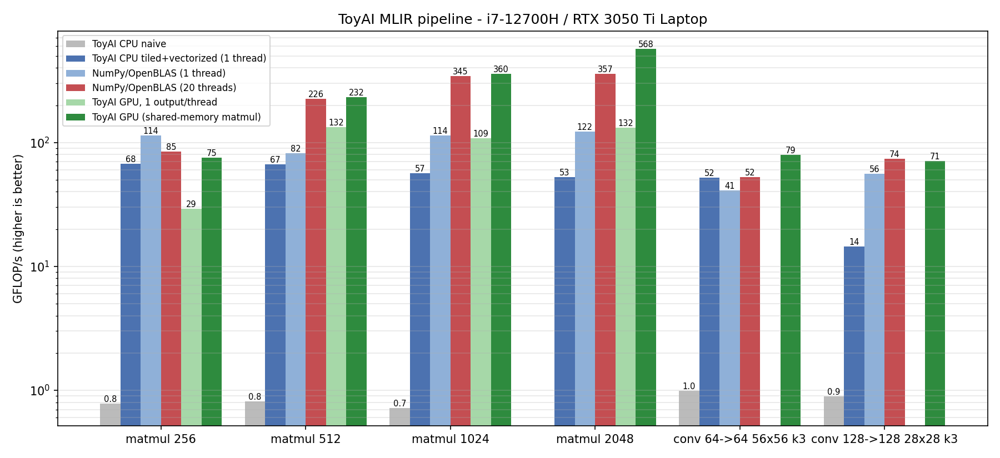
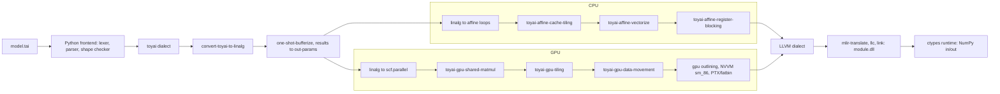

# ToyAI: a custom MLIR dialect with CPU and GPU pipelines

ToyAI is a small optimizing compiler for machine-learning kernels. You write
array programs in a tiny language (`.tai`); a Python frontend parses them
into a custom MLIR dialect, and C++ passes lower that dialect through
`linalg` either to cache-tiled, vectorized `affine` loops for the CPU or to
NVVM kernels for an NVIDIA GPU. Both end up as LLVM IR, are compiled to a
native DLL and are called directly from Python on NumPy arrays.



| GFLOP/s (i7-12700H, RTX 3050 Ti Laptop) | CPU naive | **CPU optimized** (1 thread) | NumPy 1 thread | NumPy 20 threads | GPU, simple kernel | **GPU** |
|---|---:|---:|---:|---:|---:|---:|
| matmul 1024 | 0.7 | 57 | 114 | 345 | 109 | 360 |
| matmul 2048 | - | 53 | 122 | 357 | 132 | 568 |
| conv 64->64, 56x56, 3x3 | 1.0 | 52 | 41 | 52 | - | 79 |
| conv 128->128, 28x28, 3x3 | 0.9 | 14 | 56 | 74 | - | 71 |

GPU numbers include copying inputs to the device and results back. The CPU
pipeline is single-threaded; its counterpart is "NumPy 1 thread". Results come
from `python benchmarks/bench.py`; raw data is in
[docs/benchmarks.json](docs/benchmarks.json).

## Pipeline



## The language

```python
# examples/mlp_layer.tai
def mlp_layer(X: f32[64, 256], W: f32[256, 128], B: f32[64, 128]) -> f32[64, 128] {
  H = X @ W + B;
  return relu(H);
}
```

Builtins: `matmul(a, b)` / `a @ b`, `add(a, b)` / `a + b`, `relu(x)`,
`conv2d(x, w, stride=s, padding=p)` (NCHW input, FCHW filter) and
`full([shape], value)`. All tensors are statically shaped `f32`. The parser
is a hand-written recursive-descent parser
([python/toyai/parser.py](python/toyai/parser.py)), and shape errors point at
the source:

```
model.tai:3:10: error: matmul contraction mismatch: f32[64, 256] @ f32[128, 128] (256 != 128)
```

## The ToyAI dialect

Defined in ODS ([include/ToyAI/ToyAIOps.td](include/ToyAI/ToyAIOps.td)):

| op | semantics |
|---|---|
| `toyai.matmul` | 2-D matrix product, result type inferred |
| `toyai.conv2d` | NCHW x FCHW convolution with `strides` / `padding`, result type inferred |
| `toyai.add` | elementwise sum |
| `toyai.relu` | `max(x, 0)`; `relu(relu(x))` folds to `relu(x)` |
| `toyai.constant` | tensor filled with a scalar |

```mlir
%0 = toyai.matmul %X, %W : (tensor<64x256xf32>, tensor<256x128xf32>) -> tensor<64x128xf32>
%1 = toyai.add %0, %B : (tensor<64x128xf32>, tensor<64x128xf32>) -> tensor<64x128xf32>
%2 = toyai.relu %1 : (tensor<64x128xf32>) -> tensor<64x128xf32>
```

## Passes

| pass | what it does |
|---|---|
| `convert-toyai-to-linalg` | `matmul` to `linalg.matmul`, `conv2d` to `tensor.pad` + `linalg.conv_2d_nchw_fchw`, `add`/`relu` to elementwise `linalg.generic`, `constant` to `linalg.fill` |
| `toyai-memref-copy-to-linalg` | turns the copies bufferization creates for padding into `linalg.copy`, so they become ordinary loops/kernels |
| `toyai-affine-cache-tiling` | moves the loop that walks the fastest-varying dimension of the most accesses innermost (matmul i-j-k becomes i-k-j), checked with `isValidLoopInterchangePermutation`. It then tiles with sizes from an L1/L2 model (defaults: 48 KiB / 1.25 MiB for the 12700H P-cores). |
| `toyai-affine-vectorize` | innermost unit-stride loops become `affine.vector_load/store` on `vector<8xf32>` (AVX2). Invariant loads become broadcasts, and leftover iterations go to a scalar epilogue. |
| `toyai-affine-register-blocking` | unroll-and-jams the loop around each vector loop, then forwards stores to loads and drops overwritten stores, so a C vector is loaded and stored once per 4 FMAs |
| `toyai-gpu-shared-matmul` | matmul becomes a `gpu.launch` with 64x64 tiles per block. A and B panels are staged in workgroup memory between `gpu.barrier` ops, and each thread keeps a 4x4 register tile. |
| `toyai-gpu-tiling` | for everything else: keeps reduction accumulators in registers, tiles `scf.parallel` into blocks and threads, and maps the unit-stride dimension to x for coalescing |
| `toyai-gpu-data-movement` | device copies of every buffer. It uploads only what is read before it is written and downloads what is written. |

These are assembled into two pipelines,
[lib/ToyAI/Pipelines/Pipelines.cpp](lib/ToyAI/Pipelines/Pipelines.cpp):

```
toyai-opt --pass-pipeline="builtin.module(toyai-cpu-pipeline{optimize=true l1-kb=48 l2-kb=1280 unroll=4 vector-width=8})"
toyai-opt --pass-pipeline="builtin.module(toyai-gpu-pipeline{block-x=16 block-y=16 shared-matmul=true chip=sm_86})"
```

Matmul's inner loop after the CPU pipeline has been interchanged to i-k-j,
tiled for the cache, vectorized, and register-blocked:

```mlir
affine.for %k = #map(%kk) to #map1(%kk) step 4 {
  %a0 = affine.load %A[%i, %k] : memref<256x512xf32>          // hoisted out of the j loop
  %a0v = vector.broadcast %a0 : f32 to vector<8xf32>
  ...
  affine.for %j = #map(%jj) to #map2(%jj) step 16 {
    %b0 = affine.vector_load %B[%k, %j] : memref<512x256xf32>, vector<8xf32>
    %c  = affine.vector_load %C[%i, %j] : memref<256x256xf32>, vector<8xf32>
    %p0 = arith.mulf %a0v, %b0 : vector<8xf32>
    %s0 = arith.addf %c, %p0 : vector<8xf32>
    ...                                                       // k+1, k+2, k+3 reuse %s0 in registers
    affine.vector_store %s3, %C[%i, %j] : memref<256x256xf32>, vector<8xf32>
    ...                                                       // second vector of the unrolled j loop
  }
}
```

## Building (Windows)

Requirements: Visual Studio 2022+ with the *Desktop development with C++*
workload, Python 3.10+ with `numpy`, `cmake`, `ninja`, `lit`, `pytest` and
`matplotlib`, and the CUDA Toolkit 12.x for the GPU path.

```powershell
pip install numpy cmake ninja lit pytest matplotlib

# 1. LLVM/MLIR 21.1.8 with X86 + NVPTX and the MLIR CUDA runtime (about 1 hour)
powershell -ExecutionPolicy Bypass -File scripts\build_llvm.ps1      # -> D:\U\toolchains\llvm-install

# 2. ToyAI (toyai-opt + lit tests)
powershell -ExecutionPolicy Bypass -File scripts\build.ps1 -Test
```

`scripts/env.ps1` loads the MSVC x64 environment and puts LLVM, CUDA and
`build/bin` on `PATH` (`. .\scripts\env.ps1`). Set `TOYAI_TOOLCHAIN_ROOT` /
`TOYAI_LLVM_INSTALL` to use a different toolchain location. Toolchains often
mishandle spaces and `&` in paths, so it's easiest to build from a junction
with a simple path (for example `D:\U\gpu-pipeline`).

## Usage

```powershell
$env:PYTHONPATH = "python"
python -m toyai emit  examples\mlp_layer.tai                 # ToyAI dialect
python -m toyai lower examples\mlp_layer.tai --target cpu    # LLVM dialect after the CPU pipeline
python -m toyai run   examples\conv2d.tai    --target gpu    # compile, run, compare with NumPy
```

```python
import numpy as np
from toyai.compiler import compile_source

mod = compile_source("""
def mlp(X: f32[64,256], W: f32[256,128], B: f32[64,128]) -> f32[64,128] {
  return relu(X @ W + B);
}""", target="gpu")

out = mod.mlp(np.random.rand(64, 256).astype(np.float32),
              np.random.rand(256, 128).astype(np.float32),
              np.zeros((64, 128), np.float32))
```

Compiled modules are cached in `.toyai_cache/` by content hash. Each cache
entry keeps the intermediate `input.mlir`, `lowered.mlir` and `module.ll`
for inspection.

## Tests

```powershell
cmake --build build --target check-toyai     # lit + FileCheck: dialect, conversion, every pass, both pipelines
python -m pytest python/tests                # frontend + end-to-end CPU and GPU runs checked against NumPy
```

## Design notes

* **Calling convention.** Functions are bufferized with identity layouts at
  their boundaries, and `buffer-results-to-out-params{hoist-static-allocs}`
  turns the result into a trailing out-parameter. As a result, the exported
  `_mlir_ciface_f(A*, B*, Out*)` writes straight into a NumPy array, with no
  allocation crossing the DLL boundary.
* **No aliasing.** ToyAI buffers never alias. Every argument is a separate
  array and every temporary a separate allocation. Register blocking relies on
  this guarantee to forward and delete stores that `affine-scalrep` has to keep.
* **Staying affine when vectorizing.** The upstream `affine-super-vectorize`
  emits `vector.transfer_*` ops, which the affine passes after it cannot
  analyze. `toyai-affine-vectorize` emits `affine.vector_load/store` instead,
  so unroll-and-jam and store forwarding still work on the vectorized loop.
* **GPU modules and DllMain.** MLIR loads GPU binaries from `llvm.global_ctors`.
  In a Windows DLL those run inside `DllMain` under the loader lock, where
  `cuInit` deadlocks. The driver rewrites them into exported `toyai_init` /
  `toyai_fini` functions, which the runtime calls after `LoadLibrary`.
* **Async GPU code.** The data-movement pass emits plain synchronous
  `gpu.alloc` / `gpu.memcpy` ops. Upstream `gpu-async-region` then chains them
  and the kernel launches on one stream, with a single synchronization point
  at the end.

## Limitations and next steps

* Static shapes and `f32` only; no dynamic dimensions or broadcasting.
* The CPU code is single-threaded. Mapping the outer tile loops to threads
  (e.g. `async` or OpenMP dialect) is the obvious next step.
* Convolution on the CPU is not register-blocked across output channels, so
  small-spatial / many-channel convolutions stay well below matmul speed.
* GPU transfers use pageable host memory; pinning NumPy buffers or keeping
  tensors resident on the device across calls would remove most of the
  copy time for small problems.

## Repository layout

```
include/ToyAI/      ODS: dialect, ops, passes; pipeline options
lib/ToyAI/          IR, Conversion/ToyAIToLinalg, Transforms/*, Pipelines
tools/toyai-opt/    mlir-opt style driver
test/               lit + FileCheck tests
python/toyai/       lexer, parser, shape checker, emitter, compiler driver, ctypes runtime
python/tests/       pytest: frontend, CPU and GPU end-to-end
benchmarks/         bench.py (results in docs/)
examples/           .tai programs
scripts/            toolchain and project build scripts
```
